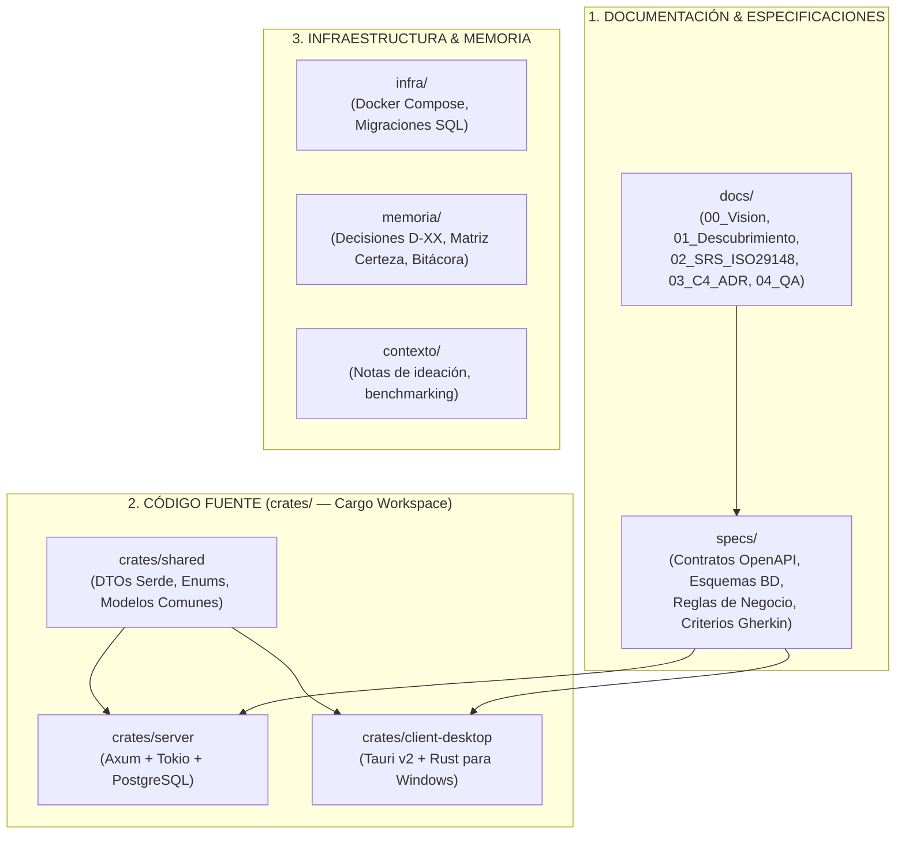

# 🛡️ Mamori (守り)

**Plataforma Integral de Seguridad, Control de Acceso y Gestión Operativa para Unidades Residenciales.**  
*Arquitectura Monorepo Cargo Workspace (Rust) | Terminal Windows Nativa | Servidor Central Axum | ISO/IEC/IEEE 29148 | SDD*

---

## 🏛️ Mapa de Navegación del Repositorio

---

## 📂 Directorio de Carpetas Clave

### 🧠 Gobernanza y Memoria Viva ([`memoria/`](memoria/))
- [AGENTS.md](AGENTS.md) — Manual de operaciones, 10 Reglas de Oro y Límites Operativos.
- [acuerdos_y_decisiones_clave.md](memoria/acuerdos_y_decisiones_clave.md) — Registro inmutable de decisiones firmes (`D-01..`) y abiertas (`DA-01..`).
- [matriz_certeza_real_vs_propuesta.md](memoria/matriz_certeza_real_vs_propuesta.md) — Semáforo de madurez técnica (`🟢 Real` / `🟡 Propuesta` / `🔴 Pendiente`).
- [bitacora_aprendizajes.md](memoria/bitacora_aprendizajes.md) — Registro histórico cronológico de aprendizajes técnicos.
- [glosario_terminos_negocio.md](memoria/glosario_terminos_negocio.md) — Diccionario de términos del dominio residencial.

### 📐 Ingeniería, Requerimientos y Especificaciones
- [product_charter.md](docs/00_vision_y_roadmap/product_charter.md) — Visión de producto, propuesta de valor y roadmap del MVP.
- [`docs/02_requerimientos_srs/`](docs/02_requerimientos_srs/) — Requerimientos formales bajo ISO/IEC/IEEE 29148.
- [`docs/03_arquitectura_c4_y_adr/`](docs/03_arquitectura_c4_y_adr/) — Modelo C4 y Registros de Decisiones de Arquitectura (ADRs).
- [`specs/`](specs/) — Especificaciones ejecutables (SDD): Contratos API, Esquemas SQL, Reglas y Gherkin.

### 🦀 Software (Cargo Workspace en [`crates/`](crates/))
- [`crates/shared/`](crates/shared/) — Crate de dominio compartido (modelos Serde de visitantes, vehículos, unidades y paquetería).
- [`crates/server/`](crates/server/) — Servidor central en Rust (Axum, Tokio, SQLx).
- [`crates/client-desktop/`](crates/client-desktop/) — Terminal de portería Windows (Tauri v2 + Rust).
- [`infra/docker/`](infra/docker/) — Entorno local de desarrollo (PostgreSQL con Docker Compose).
