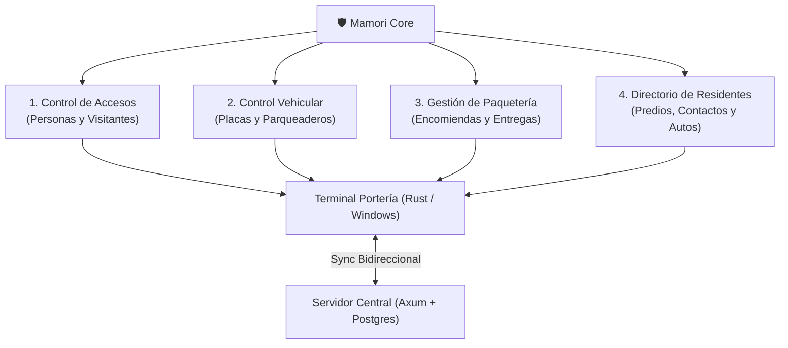

# Product Charter y Visión de Producto (product_charter.md)

**Producto:** Mamori (守り)  
**Propósito:** Sistema Integral de Seguridad, Control de Acceso y Gestión Operativa para Unidades Residenciales  
**Tipo de Proyecto:** Startup Propia / Producto de Software  
**Versión de Especificación:** 1.0 — 2026  

---

## 1. Visión y Propuesta de Valor

### 1.1 El Problema
En la gran mayoría de conjuntos residenciales, condominios y edificios:
- El registro de visitantes y vehículos se sigue haciendo en **cuadernos físicos de papel**, lento, ilegible y sin trazabilidad.
- La paquetería y encomiendas se acumulan en portería sin un control estricto de quién recibió ni cuándo se entregó al residente, generando pérdidas y reclamos.
- La comunicación entre portería y residentes es deficiente (citófonos dañados, números desactualizados).
- Los sistemas existentes suelen ser lentos, requieren navegadores web propensos a cierres accidentales o son soluciones costosas que no toleran caídas de internet.

### 1.2 La Solución Mamori
**Mamori** es una plataforma de software de alta eficiencia diseñada específicamente para la seguridad y control de acceso en porterías:
- **Terminal de Escritorio Nativa (Windows) en Rust:** Ultra rápida, ligera, enfocada en atajos de teclado para vigilantes y con soporte para hardware local (lectores de cédula/barras, impresoras de tiquetes).
- **Servidor Central Concurrente (Rust + Axum + PostgreSQL):** Sincronización en tiempo real, gestión multi-portería y almacenamiento seguro de auditoría.
- **Resiliencia Local (Offline-First):** La portería sigue funcionando aunque se caiga la conexión a internet.

---

## 2. Módulos Funcionales del Producto (Alcance MVP)

### 2.1 Módulo 1: Control de Acceso de Personas
- Registro ágil de visitantes (Cédula/Documento, Nombre, Apto/Casa destino).
- Estado de autorización (`Pendiente`, `Autorizado`, `Denegado`, `Dentro`, `Salida`).
- Trazabilidad con timestamp exacto de entrada y salida.

### 2.2 Módulo 2: Control Vehicular
- Registro de placa, tipo de vehículo (carro, moto, bicicleta, camión).
- Control de cupo y asignación de parqueaderos de visitantes.
- Alertas de vehículos con tiempo excedido.

### 2.3 Módulo 3: Paquetería y Encomiendas
- Registro rápido de paquetes recibidos en portería (Empresa de mensajería, predio destino, destinatario, foto/número de guía).
- Notificación al residente.
- Entrega con firma o confirmación de entrega en portería.

### 2.4 Módulo 4: Gestión de Residentes e Inmuebles
- Directorio de torres, bloques, apartamentos y casas.
- Residentes principales, residentes secundarios y números de contacto / citofonía.
- Vehículos autorizados por predio.

---

## 3. Hoja de Ruta (Roadmap)

| Fase | Hito | Entregable / Estado |
| :---: | :--- | :--- |
| **Fase 1** | **Ingeniería & Requerimientos** | SRS ISO/IEC/IEEE 29148, arquitectura C4 y contratos SDD en `specs/`. |
| **Fase 2** | **Crate Compartido y Backend Base** | Modelos en `crates/shared` y API base en `crates/server` con PostgreSQL. |
| **Fase 3** | **Terminal Windows de Portería** | Interfaz de usuario y lógica local en `crates/client-desktop` (Rust). |
| **Fase 4** | **Sincronización y Notificaciones** | Protocolo de sincronización en tiempo real y módulo de avisos a residentes. |
| **Fase 5** | **Pruebas de Campo e Instalador** | Generación de instalador `.msi` para Windows y pruebas operativas. |
