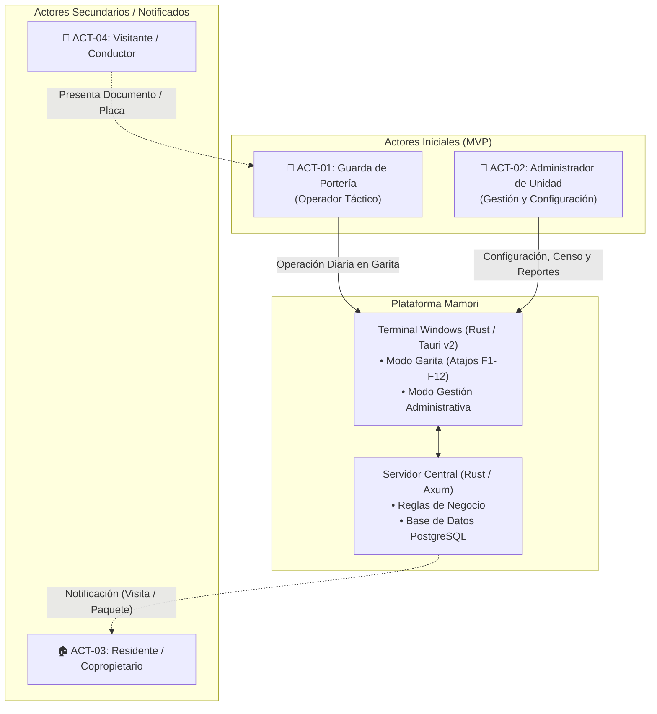

# Catálogo de Actores y Perfiles de Usuario (actores_y_perfiles.md)

**Proyecto:** Mamori (守り)  
**Módulo:** Descubrimiento y Roles del Sistema  
**Última Actualización:** 2026-11-22  

---

## 1. Mapa de Actores del Sistema

---

## 2. Fichas de Perfil de Usuario (Personas)

### 👮 ACT-01: Guarda / Vigilante de Portería
* **Entorno de Trabajo:** Garita / Caseta de vigilancia de la portería vehicular o peatonal. Hardware típico: PC de escritorio con Windows, monitor, teclado/mouse, lector de código de barras USB y posible impresora térmica.
* **Contexto Operativo:** Entorno de alta presión y rapidez. Llegan filas de vehículos y visitantes en horas pico. No puede perder tiempo navegando menús complejos con el mouse.
* **Responsabilidades Clave:**
  - Registrar ingresos y salidas de personas (visitantes, domiciliarios, contratistas).
  - Registrar ingresos y salidas de vehículos (asignar bahías de parqueadero, control de cupos).
  - Recibir encomiendas/paquetes de couriers y entregarlos a los residentes con registro de descargo.
  - Consultar directorio de predios y teléfonos de citofonía para autorizaciones.
  - Registrar novedades operativas o incidentes de seguridad en la bitácora/minuta digital.
* **Requerimientos Ergonómicos y UX:**
  - Operación 100% mediante **atajos de teclado** (`F1`, `F2`, `F3`, `Enter`, `Esc`).
  - Pantallas de alto contraste con tipografía grande y legible a distancia.
  - Operación **Local-First**: La terminal no debe bloquearse si se cae la conexión a internet.

---

### 👔 ACT-02: Administrador de la Unidad Residencial
* **Entorno de Trabajo:** Oficina de administración del conjunto residencial o equipo portátil.
* **Contexto Operativo:** Gestión estratégica, auditoría, resolución de conflictos de convivencia y parametrización de la copropiedad.
* **Responsabilidades Clave:**
  - Configurar la estructura física de la unidad: Torres, Bloques, Apartamentos, Casas, Celdas de Parqueadero.
  - Gestionar el censo de residentes: altas, bajas y cambios de propietarios e inquilinos.
  - Auditar bitácoras de acceso, reportes de permanencia vehicular y tiempos de entrega de paquetería.
  - Configurar políticas de seguridad: tiempos máximos de parqueo de visitantes, requisitos para contratistas, restricciones de ingreso.
  - Gestionar las cuentas y credenciales de los guardas de seguridad.

---

## 3. Matriz de Permisos Base (RBAC Preliminar)

| Módulo / Funcionalidad | 👮 Guarda de Portería (`ACT-01`) | 👔 Administrador (`ACT-02`) |
| :--- | :---: | :---: |
| **Registro de Entrada / Salida (Personas y Autos)** | 🟢 Crear y Consultar | 🟢 Solo Lectura / Auditoría |
| **Recepción y Entrega de Paquetes** | 🟢 Operación Total | 🟢 Consulta y Auditoría |
| **Registro de Novedades / Minuta** | 🟢 Registrar en su Turno | 🟢 Consulta y Cierre Formal |
| **Crear / Editar / Eliminar Inmuebles (Predios)** | 🔴 Sin Acceso | 🟢 Control Total |
| **Censo de Residentes (Altas y Bajas)** | 🟡 Solo Consulta / Búsqueda | 🟢 Control Total |
| **Configurar Políticas y Tiempos de Parqueadero** | 🔴 Sin Acceso | 🟢 Control Total |
| **Gestión de Usuarios y Credenciales** | 🔴 Sin Acceso | 🟢 Control Total |
