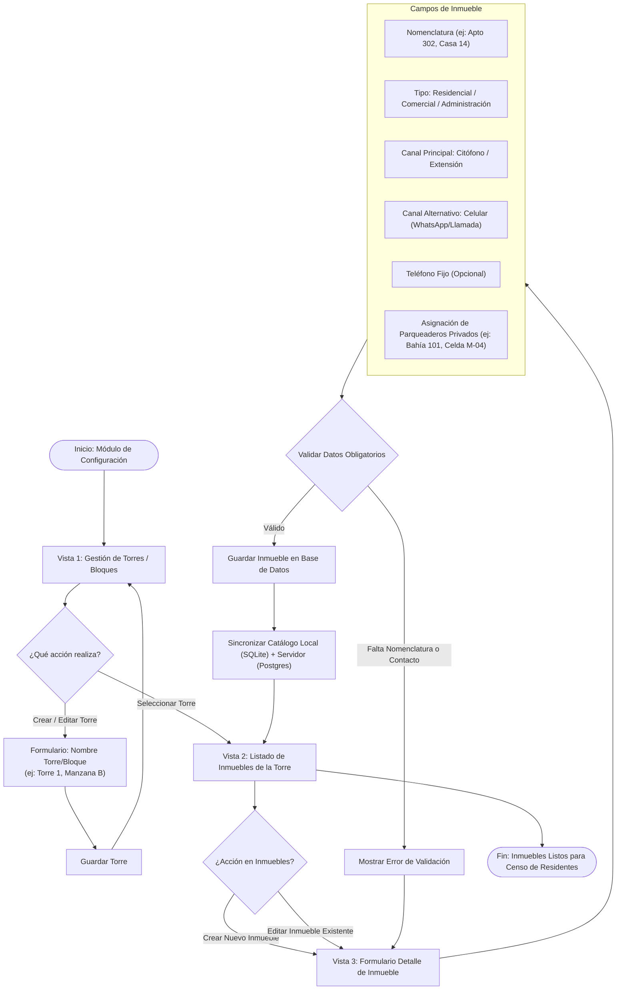

# FLP-01: Flujo de Configuración de Copropiedad, Torres e Inmuebles

**Código:** `FLP-01`  
**Módulo:** Configuración de Estructura Física y Predios  
**Actores:** Administrador de la Copropiedad (`ACT-02`), Guarda de Portería (`ACT-01` con permisos)  
**Estado:** 🟢 `[CONFIRMADO POR FUNDADOR]`  
**Última Actualización:** 2026-11-22  

---

## 1. Propósito y Alcance del Flujo
Permitir al usuario (Administrador o Guarda autorizado) configurar la estructura física de la unidad residencial:
1. Crear y parametrizar las **Torres o Bloques**.
2. Registrar los **Inmuebles (Apartamentos o Casas)** asignados a cada torre o bloque.
3. Asignar los canales de comunicación obligatorios para la garita:
   - **Número de Citófono / Extensión**.
   - **Teléfono Celular** (principal para notificaciones o en caso de carecer de citófono físico).
   - **Teléfono Fijo** (opcional).
4. Asignar y vincular los **Parqueaderos Privados** propios del inmueble (número de bahía/celda).

---

## 2. Diagrama del Proceso Operativo y Navegación de Vistas



---

## 3. Especificación de Vistas de Usuario (Terminal Windows)

### 🖥️ Vista 1: Selector y Gestión de Torres / Bloques
* **Atajos de Teclado:** `[N]` Nueva Torre, `[Enter]` Abrir Inmuebles, `[F2]` Renombrar, `[Esc]` Volver al Menú Principal.
* **Componentes:**
  - Tarjetas / Cuadrícula interactiva con las torres creadas (ej: `Torre A`, `Torre B`, `Manzana 1`).
  - Cada tarjeta muestra resumen: Total de apartamentos creados y estado de ocupación.

### 🖥️ Vista 2: Directorio de Inmuebles por Torre
* **Atajos de Teclado:** `[Ins]` o `[F1]` Agregar Inmueble, `[Enter]` Editar, `[F3]` Buscar por número de apto, `[Del]` Desactivar.
* **Tabla de Datos:**
  | Torre | Inmueble | Tipo | Citófono | Celular Contacto | Tel. Fijo | Parq. Privados |
  | :--- | :---: | :---: | :---: | :---: | :---: | :---: |
  | Torre 1 | **Apto 101** | Residencial | Ext. 101 | 300 123 4567 | (604) 444 0000 | P-101 |
  | Torre 1 | **Apto 102** | Residencial | *(Sin citófono)* | 315 987 6543 | - | P-102, P-102B |
  | Torre 1 | **Apto 103** | Residencial | Ext. 103 | 311 555 8899 | - | *(Sin parqueadero)* |

### 🖥️ Vista 3: Formulario Modal de Creación / Edición de Inmueble
Campos estructurados en la interfaz de usuario:
1. **Torre / Bloque:** Seleccionado por defecto (desplegable).
2. **Número de Inmueble:** Campo de texto (ej: `101`, `102A`, `Casa 25`).
3. **Tipo de Inmueble:** Selector (`Apartamento`, `Casa`, `Oficina/Local`, `Depósito`).
4. **Canales de Citofonía y Contacto de Garita:**
   - `[ ] Tiene citófono físico` ➔ Campo: *Número de Extensión / Citófono*.
   - `[X] Teléfono Celular Principal` ➔ Campo: *Número móvil (10 dígitos)* (Indispensable para garita si no hay citófono).
   - `[ ] Teléfono Fijo` ➔ Campo: *Número fijo local*.
5. **Parqueaderos Privados Asignados:**
   - Selector / etiquetas múltiples: Permite agregar una o varias bahías privadas pertenecientes a este predio (ej: `P-101`, `MOTO-05`).

---

## 4. Reglas de Negocio Inviolables (`RN-UN-XX`)

* `RN-UN-01 [Unicidad de Nomenclatura]:` No puede existir más de un inmueble con el mismo número dentro de la misma Torre/Bloque.
* `RN-UN-02 [Mínimo Canal de Comunicación]:` Todo inmueble debe registrar **al menos un canal de contacto activo** (Citófono/Extensión O Teléfono Celular). La portería no puede tener un inmueble aislado sin forma de comunicación.
* `RN-UN-03 [Formato Celular]:` Si se especifica un número celular, debe cumplir con la validación de formato numérico estándar (ej. 10 dígitos para Colombia o código de país prefijado).
* `RN-UN-04 [Parqueaderos Privados Exclusivos]:` Una misma celda o bahía de parqueadero privado no puede estar asignada simultáneamente a dos inmuebles distintos, salvo que se marque explícitamente como parqueadero compartido.
* `RN-UN-05 [Inmutabilidad Histórica]:` Si un inmueble se desocupa o cambia de propietarios, **no se elimina el registro** del inmueble; se mantiene su estructura física y se desvinculan los residentes del censo.

---

## 5. Casos Extremos y Excepciones Operativas (`FA-XX`)

* **FA-01 [Inmueble sin Citófono Físico]:** En muchas unidades residenciales antiguas o en avería, los citófonos no funcionan. El sistema permite marcar el predio como *"Sin citófono"* y activa automáticamente el número celular como canal de discado / contacto prioritario desde la terminal de portería.
* **FA-02 [Predio con Múltiples Parqueaderos Privados]:** Apartamentos penthouse o casas con 2 a 4 bahías (ej: 2 para carros y 1 para moto). El sistema permite asociar una lista de parqueaderos (`Vec<String>`).
* **FA-03 [Predio sin Parqueadero Privado]:** Unidades de apartaestudios sin bahía asignada. El sistema valida `0` parqueaderos y no genera restricción.

---

## 6. Modelo de Datos de Dominio (Rust Serde / SQL)

```rust
pub struct TowerBlock {
    pub id: Uuid,
    pub name: String, // ej: "Torre 1", "Bloque A"
}

pub struct ResidentialUnit {
    pub id: Uuid,
    pub tower_id: Uuid,
    pub unit_number: String,       // ej: "302", "Casa 12"
    pub unit_type: UnitType,       // Apartment, House, Commercial
    pub intercom_extension: Option<String>, // Número de citófono físico
    pub mobile_phone: Option<String>,       // Celular prioritario si no hay citófono
    pub landline_phone: Option<String>,     // Fijo
    pub private_parking_spots: Vec<String>, // ["P-302A", "P-302B"]
    pub is_active: bool,
}
```
