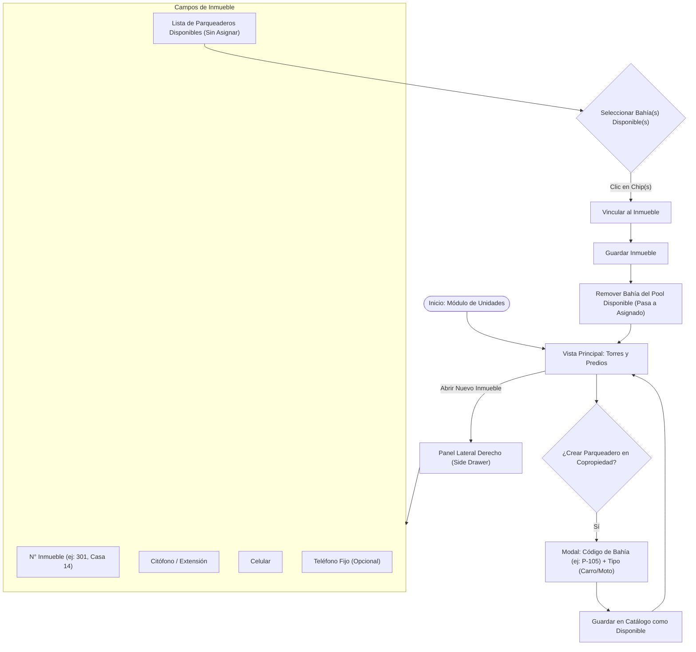

# FLP-01: Flujo de Configuración de Copropiedad, Torres e Inmuebles

**Código:** `FLP-01`  
**Módulo:** Configuración de Estructura Física y Predios  
**Actores:** Administrador de la Copropiedad (`ACT-02`), Guarda de Portería (`ACT-01` con permisos)  
**Estado:** 🟢 `[CONFIRMADO POR FUNDADOR]`  
**Última Actualización:** 2026-11-24  

---

## 1. Propósito y Alcance del Flujo
Permitir al usuario (Administrador o Guarda autorizado) configurar la estructura física de la unidad residencial:
1. Crear y parametrizar las **Torres o Bloques**.
2. Crear y gestionar el **Catálogo de Parqueaderos** de la copropiedad (Carro, Moto, etc.).
3. Registrar los **Inmuebles (Apartamentos o Casas)** asignados a cada torre o bloque.
4. Asignar los canales de comunicación obligatorios para la garita:
   - **Número de Citófono / Extensión**.
   - **Teléfono Celular**.
   - **Teléfono Fijo** (opcional).
5. Asignar **Parqueaderos Privados** propios del inmueble seleccionando exclusivamente del **pool de parqueaderos disponibles** (no asignados previamente a otra unidad), permitiendo asociar múltiples celdas por predio.

---

## 2. Diagrama del Proceso Operativo y Navegación de Vistas

---

## 3. Especificación de Vistas de Usuario (Terminal Windows)

### 🖥️ Vista 1: Selector de Torres y Parqueaderos (Panel Izquierdo)
* Lista de torres creadas con contador de apartamentos.
* Botón de acción: `NUEVA TORRE / BLOQUE`.
* Sub-módulo: **PARQUEADEROS COPROPIEDAD** con botón **`CREAR PARQUEADERO`**.

### 🖥️ Vista 2: Directorio de Inmuebles (Panel Central)
* Tabla de predios: `INMUEBLE` | `TIPO` | `CITÓFONO / EXT.` | `CELULAR` | `TEL. FIJO` | `PARQUEADEROS PRIVADOS`.
* Botón: `NUEVO INMUEBLE` que abre el panel lateral derecho.
* Clic en cualquier fila: abre la **Ficha del Inmueble** (panel lateral de solo lectura con contactos, parqueaderos, residentes, visitas dentro y paquetes pendientes) y desde ahí `EDITAR` (D-34, REQ-UN-12).

### 🖥️ Vista 3: Panel Lateral Derecho (Side Drawer) de Nuevo Inmueble
* Despliegue lateral de 500px sin tapar el contexto, descartable con tecla `ESC` o botón de cierre.
* **Sección de Parqueaderos Privados Asignados:**
  * No muestra desplegables estáticos permanentes.
  * Muestra la lista de celdas asignadas al predio con indicador visual táctico y botón `ELIMINAR`.
  * Botón de acción: `ASIGNAR PARQUEADERO` que despliega un **sub-panel inferior interactivo**.
  * **Sub-Panel Inferior de Celdas Disponibles:**
    - Buscador en tiempo real por código (ej: `P-105`) o tipo (`Carro` / `Moto`).
    - Listado con tarjetas tácticas de bahías disponibles (excluyendo celdas previamente asignadas).
    - Al hacer clic en cualquier celda, esta **se asigna al inmueble y el sub-panel se cierra automáticamente**, regresando al formulario principal.
    - Si el usuario requiere más celdas, puede pulsar nuevamente `ASIGNAR PARQUEADERO` repitiendo el flujo con las celdas restantes.
  * Botón directo: `NUEVO PARQUEADERO` para dar de alta una bahía nueva en el momento si falta en el sistema y auto-asignarla.

---

## 4. Reglas de Negocio Inviolables (`RN-UN-XX`)

* `RN-UN-01 [Unicidad de Nomenclatura]:` No puede existir más de un inmueble con el mismo número dentro de la misma Torre/Bloque.
* `RN-UN-02 [Mínimo Canal de Comunicación]:` Todo inmueble debe registrar al menos un canal de contacto activo (Citófono o Celular).
* `RN-UN-04 [Parqueaderos Privados Exclusivos y Exclusión Reactiva]:`
  - Un parqueadero solo puede ser asignado a **un único predio**.
  - En el formulario de creación/edición, solo se listan para selección los parqueaderos con estado **`Disponible`**.
  - **Exclusión reactiva inmediata en UI:** Tan pronto como una celda es elegida en el Option List, desaparece de las opciones desplegables del formulario. Si se remueve o el formulario se cancela, se restituye al pool de opciones disponibles.
  - Al guardar la unidad, los parqueaderos seleccionados cambian permanentemente su estado a **`Asignado`** y quedan bloqueados para cualquier otra unidad.
* `RN-UN-06 [Múltiples Parqueaderos]:` Un inmueble puede tener `0`, `1` o `N` parqueaderos privados asociados (ej. 2 carros + 1 moto).
* `RN-UN-07..11`, `RN-TR-01..03`: ver la sección 5.

---

## 5. CRUD de Inmuebles y Torres (D-30 a D-33 — 2026-11-24)

* **Inmuebles:** ver (filtrados por la torre seleccionada), crear, editar (número, tipo, contactos, parqueaderos) y eliminar.
* **Torres / Bloques:** crear, renombrar y eliminar; el contador de inmuebles es real.
* **Eliminar = inactivar** (D-31); bloqueado si el inmueble tiene residentes (D-32); **solo el Administrador elimina** (D-33).
* Reglas completas, permisos y pendientes: `specs/reglas_negocio/RN_unidades_y_torres.md`.
