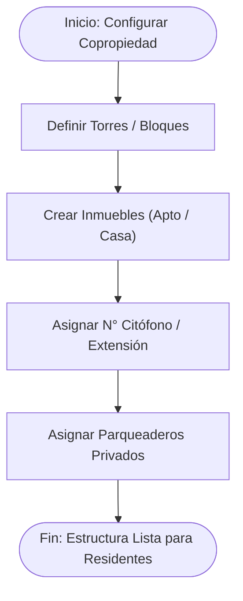

# FLP-01: Flujo de Gestión de Unidades e Inmuebles

**Código:** `FLP-01`  
**Módulo:** Configuración de Copropiedad y Predios  
**Actores:** Administrador de la Copropiedad, Supervisor de Seguridad  
**Estado:** 🟡 `[PLANTILLA LISTA PARA TU CONTENIDO]`

---

## 1. Propósito y Alcance del Flujo
Definir la estructura física y lógica de la unidad residencial (edificio, torres, manzanas, casas o apartamentos), así como los canales base de comunicación (citofonía, extensiones).

---

## 2. Diagrama del Proceso (Mermaid)

---

## 3. Descripción Paso a Paso (Flujo Principal)
1. **Identificación de la Copropiedad:** Datos generales (Nombre, NIT, dirección, número de porterías).
2. **Definición de Bloques/Torres:** Nomenclatura (ej: Torre 1, Torre 2 o Manzana A).
3. **Carga de Predios:** Registro individual o carga masiva (apartamentos, casas, locales comerciales).
4. **Asignación de Recursos:** Cupos de parqueadero asignados por escritura, depósitos/cuartos útiles.

---

## 4. Flujos Alternativos y Excepciones
- **FA-01:** Subdivisión de predios o cambio de nomenclatura.
- **FA-02:** Deshabilitación temporal de un predio por remodelación o desocupación.

---

## 5. Reglas de Negocio Asociadas
- `RN-UN-01`: La combinación `(Torre, N° de Apto)` debe ser única dentro de la unidad residencial.
- `RN-UN-02`: No se puede eliminar una unidad si tiene residentes activos asociados.

---

## 6. Datos de Entrada requeridos en Terminal / Servidor
- Nombre / Identificador de Torre o Bloque.
- Número de Predio (Apto/Casa).
- Tipo de Inmueble (Residencial, Comercial, Área Común).
- Teléfono fijo / Citófono.
