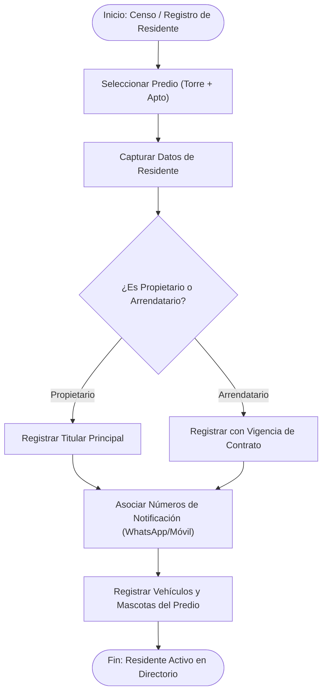

# FLP-02: Flujo de Gestión de Residentes

**Código:** `FLP-02`  
**Módulo:** Directorio de Personas y Residentes  
**Actores:** Administrador, Vigilante de Portería, Residente Principal  
**Estado:** 🟡 `[PLANTILLA LISTA PARA TU CONTENIDO]`

---

## 1. Propósito y Alcance del Flujo
Gestionar el censo poblacional de la unidad residencial: alta, actualización y baja de propietarios, inquilinos, grupo familiar, personal doméstico autorizado y contactos de emergencia.

---

## 2. Diagrama del Proceso (Mermaid)

---

## 3. Descripción Paso a Paso (Flujo Principal)
1. **Selección del Predio:** Búsqueda rápida por Torre y Número de Apartamento.
2. **Identificación:** Tipo y número de documento (Cédula, Pasaporte, CE), nombres completos.
3. **Rol en la Unidad:** Propietario residente, Arrendatario, Familiar, Empleado doméstico.
4. **Canales de Notificación:** Celular principal (para autorización de visitas y paquetería).
5. **Vehículos Vinculados:** Registro de placas autorizadas para ingresar a parqueadero privado.

---

## 4. Flujos Alternativos y Excepciones
- **FA-01:** Cambio de arrendatario (baja de inquilino anterior y archivado de autorizaciones previas).
- **FA-02:** Residente con restricción jurídica o de convivencia.

---

## 5. Reglas de Negocio Asociadas
- `RN-RES-01`: Todo predio ocupado debe tener al menos un contacto principal registrado.
- `RN-RES-02`: Los arrendatarios solo pueden registrar autorizaciones durante la vigencia de su contrato.

---

## 6. Datos de Entrada requeridos en Terminal / Servidor
- Tipo y Número de Documento.
- Nombre y Apellidos completos.
- Correo electrónico y Número de WhatsApp / Teléfono móvil.
- Rol (Propietario / Inquilino / Dependiente).
