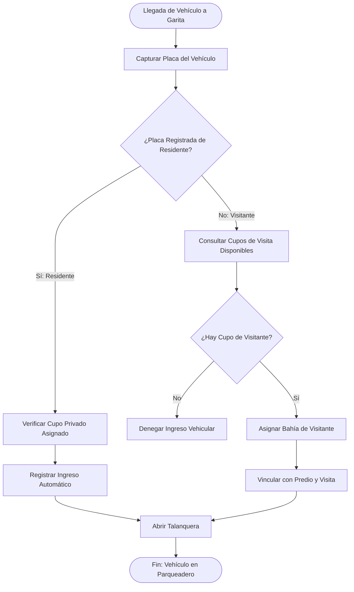

# FLP-03: Flujo de Gestión de Vehículos y Parqueaderos

**Código:** `FLP-03`  
**Módulo:** Control Vehicular y Zonas de Estacionamiento  
**Actores:** Vigilante de Portería, Residente, Conductor Visitante  
**Estado:** 🟡 `[PLANTILLA LISTA PARA TU CONTENIDO]`

---

## 1. Propósito y Alcance del Flujo
Controlar el acceso y permanencia de vehículos (automóviles, motocicletas, bicicletas) distinguiendo entre vehículos de residentes (parqueaderos privados) y vehículos de visitantes (control de cupo disponible, tiempos y tarifas si aplican).

---

## 2. Diagrama del Proceso (Mermaid)

---

## 3. Descripción Paso a Paso (Flujo Principal)
1. **Detección / Captura:** El vigilante digita la placa (o se lee mediante lector/cámara).
2. **Validación de Titularidad:** El sistema identifica si pertenece a un residente o es visitante.
3. **Asignación de Bahía:** Si es visitante, se decrementa el cupo comunal y se asigna número de celda.
4. **Registro de Salida:** Al egresar, se calcula el tiempo de estadía y se libera el cupo comunal.

---

## 4. Flujos Alternativos y Excepciones
- **FA-01:** Residente que ingresa en vehículo no registrado o vehículo de alquiler.
- **FA-02:** Vehículo de visitante excede el tiempo máximo reglamentario de parqueadero.
- **FA-03:** Conductor extravía el tiquete de ingreso vehicular.

---

## 5. Reglas de Negocio Asociadas
- `RN-VEH-01`: No se puede autorizar el ingreso de un vehículo visitante si el contador de cupos está en 0.
- `RN-VEH-02`: Una placa no puede tener dos registros de entrada activos simultáneos sin salida previa.

---

## 6. Datos de Entrada requeridos en Terminal / Servidor
- Placa (formato alfanumérico).
- Tipo de vehículo (Carro, Moto, Bicicleta, Carga).
- Número de bahía o celda asignada.
- Timestamp de entrada y salida.
