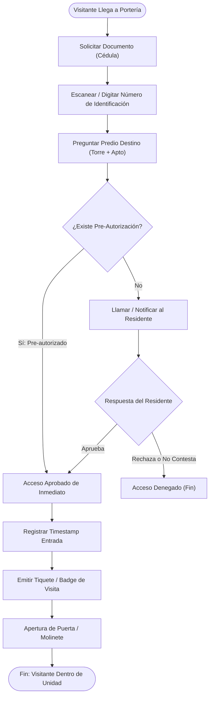

# FLP-04: Flujo de Control de Acceso de Visitantes y Contratistas

**Código:** `FLP-04`  
**Módulo:** Control de Accesos y Seguridad Peatonal  
**Actores:** Vigilante de Portería, Visitante / Contratista, Residente  
**Estado:** 🟡 `[PLANTILLA LISTA PARA TU CONTENIDO]`

---

## 1. Propósito y Alcance del Flujo
Gestionar de forma rápida y segura el ingreso y salida peatonal de visitantes ocasionales, domiciliarios, contratistas o prestadores de servicios a la copropiedad.

---

## 2. Diagrama del Proceso (Mermaid)

---

## 3. Descripción Paso a Paso (Flujo Principal)
1. **Presentación de Documento:** El visitante entrega su cédula en ventanilla de portería.
2. **Lectura Rápida:** El vigilante escanea el código de barras (PDF417) de la cédula o digita el número.
3. **Verificación de Destino:** Se indica el apartamento o casa a visitar.
4. **Validación de Autorización:**
   - Si el residente lo dejó registrado previamente en el sistema: Acceso inmediato.
   - Si no: El vigilante timbra por citófono o envía aviso al residente.
5. **Ingreso:** Se guarda el registro en la base de datos local/servidor y se emite tiquete de ingreso.
6. **Checkout / Salida:** Al salir, el vigilante marca la salida con el documento o código del tiquete.

---

## 4. Flujos Alternativos y Excepciones
- **FA-01:** Domiciliarios (ingreso restringido solo a portería o entrega express).
- **FA-02:** Contratistas de obra (requieren ARL / seguro vigente antes de ingresar).
- **FA-03:** Visitante vetado o con orden de no ingreso por parte de la administración.

---

## 5. Reglas de Negocio Asociadas
- `RN-ACC-01`: Ningún visitante puede ingresar sin documento de identidad verificado y predio asignado.
- `RN-ACC-02`: Si el residente no contesta tras `[X]` intentos, la visita no puede ser autorizada por el vigilante salvo orden escrita de administración.

---

## 6. Datos de Entrada requeridos en Terminal / Servidor
- Documento de Identidad (Tipo y Número).
- Nombre Completo.
- Predio Destino (Torre / Apto).
- Motivo de Ingreso (Familiar, Social, Domicilio, Obra/Mantenimiento).
- Foto o evidencia (opcional según hardware de garita).
