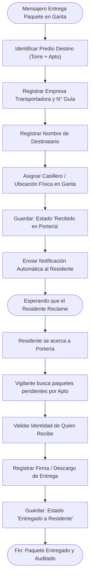

# FLP-05: Flujo de Gestión de Paquetería y Encomiendas

**Código:** `FLP-05`  
**Módulo:** Correspondencia, Paquetes y Mensajería  
**Actores:** Vigilante de Portería, Empresa de Mensajería, Residente  
**Estado:** 🟡 `[PLANTILLA LISTA PARA TU CONTENIDO]`

---

## 1. Propósito y Alcance del Flujo
Controlar el ciclo de vida de los paquetes, cartas y encomiendas recibidas en portería, desde su entrega por la transportadora hasta la entrega formal al residente o persona autorizada.

---

## 2. Diagrama del Proceso (Mermaid)

---

## 3. Descripción Paso a Paso (Flujo Principal)

### Fase A: Recepción en Portería
1. El mensajero entrega el paquete e indica la torre y apartamento.
2. El vigilante en la terminal de Windows presiona `F3` (Acceso Rápido Paquetes).
3. Selecciona el predio, ingresa transportadora (Servientrega, Amazon, etc.) y número de guía.
4. El sistema asigna un identificador de paquete y notifica al residente.

### Fase B: Entrega al Residente
1. El residente solicita sus paquetes en portería.
2. El vigilante consulta por número de predio y la terminal muestra todos los paquetes pendientes.
3. Se verifica la identidad del residente y se confirma la entrega con timestamp y firma/descargo.

---

## 4. Flujos Alternativos y Excepciones
- **FA-01:** Paquete que requiere pago contra entrega (COD / Contra Entrega) — Regla sobre si portería maneja o no dinero.
- **FA-02:** Paquete no reclamado durante más de `[X]` días.
- **FA-03:** Autorización a un tercero (empleada, vecino o familiar) para reclamar el paquete.

---

## 5. Reglas de Negocio Asociadas
- `RN-PAQ-01`: Todo paquete debe tener asignado un predio y registrar la fecha y hora exacta de recepción.
- `RN-PAQ-02`: Una vez entregado, el registro no puede ser modificado ni eliminado (inmutabilidad de auditoría).

---

## 6. Datos de Entrada requeridos en Terminal / Servidor
- Predio Destino (Torre / Apto).
- Nombre del Destinatario impreso en el paquete.
- Empresa de Mensajería (Courier).
- Número de Guía o Código de Barras del paquete.
- Ubicación en bodega/casillero de portería.
- Datos de quien retira el paquete.
