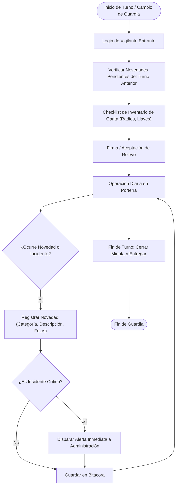

# FLP-06: Flujo de Minuta Digital y Novedades de Seguridad

**Código:** `FLP-06`  
**Módulo:** Bitácora Operativa de Vigilancia  
**Actores:** Vigilante Entrante, Vigilante Saliente, Supervisor de Seguridad, Administrador  
**Estado:** 🟡 `[PLANTILLA LISTA PARA TU CONTENIDO]`

---

## 1. Propósito y Alcance del Flujo
Reemplazar el libro físico de minuta de portería por una bitácora digital inmutable para registrar el relevo de turnos, inventario de elementos de portería (llaves maestras, radios, linternas) e incidentes de seguridad o convivencia.

---

## 2. Diagrama del Proceso (Mermaid)

---

## 3. Descripción Paso a Paso (Flujo Principal)
1. **Relevo de Turno:** El vigilante entrante inicia sesión en la terminal de Windows y revisa las consignas y paquetes que quedaron pendientes.
2. **Revisión de Inventario:** Verifica el estado de los elementos de portería (controles de puertas, llaves comunes).
3. **Registro Continuo de Novedades:** Durante el turno, cualquier evento relevante (ruido excesivo, daño en áreas comunes, llamado de la policía, trasteo no autorizado) se registra con tipología y nivel de severidad.
4. **Cierre de Turno:** Al terminar las 8 o 12 horas, se genera el reporte de cierre del turno.

---

## 4. Flujos Alternativos y Excepciones
- **FA-01:** Registro de trasteos / mudanzas (verificación de paz y salvo previo).
- **FA-02:** Préstamo y devolución de llaves de zonas comunes (salón social, terraza, cuartos de bombas).

---

## 5. Reglas de Negocio Asociadas
- `RN-MIN-01`: Los registros de minuta son inmutables; no se pueden borrar ni editar una vez confirmados. Solo se permiten notas de adición (fe de erratas).
- `RN-MIN-02`: Toda novedad de severidad alta debe notificar automáticamente a la administración.

---

## 6. Datos de Entrada requeridos en Terminal / Servidor
- Vigilante responsable (identificador o usuario).
- Tipo de evento (Relevo, Incidente, Mantenimiento, Trasteo, Alarma).
- Descripción detallada de los hechos.
- Timestamp automático.
