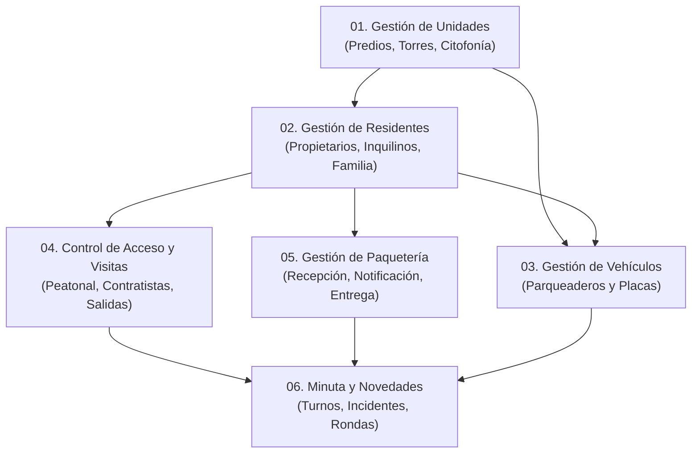

# Mapa Maestro de Flujos de Proceso — Mamori (守り)

Este directorio alberga la especificación detallada de cada proceso operativo de la unidad residencial. Cada archivo contiene la definición del flujo, los actores involucrados, reglas de negocio, manejo de excepciones y el diagrama visual en **Mermaid** (con sintaxis segura de etiquetas entrecomilladas).

---

## 🗺️ Mapa de Relación entre Flujos

---

## 📑 Índice de Archivos de Flujos

| Código | Archivo | Proceso Clave | Estado |
| :---: | :--- | :--- | :---: |
| **FLP-01** | [`01_flujo_gestion_unidades.md`](01_flujo_gestion_unidades.md) | Configuración de copropiedad, bloques/torres, predios y citofonía. | 🟡 Plantilla Lista |
| **FLP-02** | [`02_flujo_gestion_residentes.md`](02_flujo_gestion_residentes.md) | Censo, altas/bajas de propietarios, arrendatarios y contactos. | 🟡 Plantilla Lista |
| **FLP-03** | [`03_flujo_gestion_vehiculos.md`](03_flujo_gestion_vehiculos.md) | Asignación de bahías, control de cupos y vehículos de visitantes. | 🟡 Plantilla Lista |
| **FLP-04** | [`04_flujo_control_acceso_visitantes.md`](04_flujo_control_acceso_visitantes.md) | Registro de entrada peatonal, autorización y checkout de salida. | 🟡 Plantilla Lista |
| **FLP-05** | [`05_flujo_gestion_paqueteria.md`](05_flujo_gestion_paqueteria.md) | Recepción de encomiendas, alerta al residente y firma de entrega. | 🟡 Plantilla Lista |
| **FLP-06** | [`06_flujo_minuta_y_novedades.md`](06_flujo_minuta_y_novedades.md) | Libro digital de novedades, cambio de turno e incidentes. | 🟡 Plantilla Lista |
