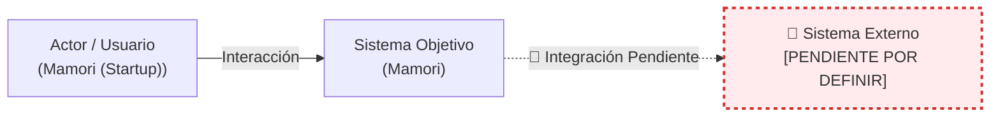

# Especificación de Requerimientos de Software (SRS)

**Proyecto:** Mamori  
**Cliente:** Mamori (Startup)  
**Versión:** 1.0 (Plantilla Base)  
**Fecha:** 2026-11-22  
**Estándares de Referencia:** ISO/IEC/IEEE 29148 | Modelo C4 | OpenAPI 3.0 | JSON Schema Draft 2020-12  

---

> ### 🚦 Declaración de Taxonomía de Certeza Técnica
> Este documento clasifica cada definición bajo tres niveles de madurez:
> - **🟢 `[CONFIRMADO / REAL]`**: Requerimiento o parámetro validado formalmente por **Mamori (Startup)**.
> - **🟡 `[PROPUESTA DE DISEÑO — SUJETA A PULIMIENTO]`**: Diseño preliminar propuesto como acelerador de ingeniería, sujeto a confirmación de insumos por parte de **Mamori (Startup)**.
> - **🔴 `[PENDIENTE POR DEFINIR]`**: Elemento abierto que requiere sesión de levantamiento o entrega de documentación del cliente.

---

## 1. Introducción y Trazabilidad Contractual

### 1.1 Propósito
Establecer la Especificación de Requerimientos de Software (SRS) para el proyecto **Mamori** de **Mamori (Startup)**, constituyendo la fuente única de verdad funcional y arquitectónica.

### 1.2 Alcance del Sistema y Fronteras
- **Alcance Fase Actual:** Levantamiento de Requerimientos (SRS), Arquitectura y Especificaciones de Producto
- **Exclusiones Explícitas (Cero Scope Creep):** 🔴 **[PENDIENTE POR DEFINIR]**

### 1.3 Matriz de Trazabilidad Contractual (`ENT-01..N`)

| ID Entregable | Entregable Contractual | Secciones del SRS que lo Cubren | Requerimientos Asociados | Estado de Certeza |
| :---: | :--- | :--- | :--- | :---: |
| **ENT-01** | Especificación Funcional y SRS | Secciones 2, 3 y 4 | `RF-01` .. `RF-NN` | 🔴 **[PENDIENTE POR DEFINIR]** |
| **ENT-02** | Arquitectura C4 y Contratos | Sección 3.3 y 3.4 | `RNF-01` .. `RNF-NN` | 🔴 **[PENDIENTE POR DEFINIR]** |

---

## 2. Modelado del Sistema en 4 Perspectivas

### 2.1 Perspectiva de Contexto (Frontera del Sistema y Actores)



### 2.2 Perspectiva de Interacción (Casos de Uso y Secuencias)
- 🔴 **[PENDIENTE POR DEFINIR — Se completará tras las sesiones de descubrimiento en `01_descubrimiento/minutas/`]**

### 2.3 Perspectiva de Estructura (Arquitectura C4 y Modelo de Datos)
- **Nivel C1 (Contexto) y Nivel C2 (Contenedores):** 🔴 **[PENDIENTE POR DEFINIR]**

### 2.4 Perspectiva de Comportamiento (Máquina de Estados y Reglas)
- **Flujo de Estados y Escalamiento HITL:** 🔴 **[PENDIENTE POR DEFINIR]**

---

## 3. Especificación de Requerimientos

### 3.1 Restricciones Negativas Inmutables (`RN-XX` — Lo que el sistema NO debe hacer)

| ID Restricción | Descripción de la Prohibición / Guardrail Operativo | Estado |
| :---: | :--- | :---: |
| **RN-01** | El sistema **NO** debe inventar, inferir ni alucinar datos transaccionales que no provengan de una fuente oficial validada. | 🟢 **[CONFIRMADO / REAL]** |

---

### 3.2 Requerimientos Funcionales (`RF-XX`)

#### RF-01: [Nombre del Requerimiento Funcional]
- **Estado de Certeza:** 🔴 **[PENDIENTE POR DEFINIR]** *(o 🟡 Propuesta / 🟢 Confirmado)*
- **Entregable Contractual:** `ENT-01`
- **Prioridad:** Alta (Must Have)
- **Especificación (Sintaxis EARS):** *Cuando [evento disparador], mientras [precondición], el sistema deberá [respuesta determinista].*
- **Entradas:** 🔴 **[PENDIENTE POR DEFINIR]**
- **Procesamiento y Reglas:** 🔴 **[PENDIENTE POR DEFINIR]**
- **Salidas:** 🔴 **[PENDIENTE POR DEFINIR]**
- **Insumo requerido de Mamori (Startup) para pasar a 🟢 Real:** [Indicar documento, API o confirmación necesaria]
- **Criterio de Aceptación (Gherkin):**
  ```gherkin
  Escenario: [Nombre del escenario verificable]
    Dado que [contexto inicial verificado]
    Cuando [acción del actor o evento del sistema]
    Entonces [resultado esperado medible]
  ```

---

### 3.3 Requerimientos No Funcionales (`RNF-XX` — ISO/IEC 25010)

| ID | Categoría | Especificación y Métrica Verificable (SLA / SLO) | Estado de Certeza |
| :---: | :--- | :--- | :---: |
| **RNF-01** | Rendimiento y Latencia | 🔴 **[PENDIENTE POR DEFINIR]** | 🔴 PENDIENTE |
| **RNF-02** | Seguridad y Privacidad | Cifrado TLS 1.3 en tránsito, AES-256 en reposo y control de acceso por roles (RBAC). | 🟡 PROPUESTA |
| **RNF-03** | Disponibilidad | 🔴 **[PENDIENTE POR DEFINIR]** | 🔴 PENDIENTE |
| **RNF-04** | Trazabilidad y Auditoría | Registro inmutable de logs de ejecución y correlación de eventos. | 🟡 PROPUESTA |

---

## 4. Matriz General de Trazabilidad (Requerimientos ➔ SDD ➔ Pruebas)

| ID Req | Nombre | Entregable (`ENT`) | Decisión (`D-XX`) | Contrato SDD (`proyecto/specs/`) | Escenario Gherkin / UAT | Estado |
| :---: | :--- | :---: | :---: | :--- | :--- | :---: |
| **RF-01** | [Pendiente] | `ENT-01` | `D-01` | `specs/contratos_api/...` | `specs/criterios_gherkin/...` | 🔴 PENDIENTE |