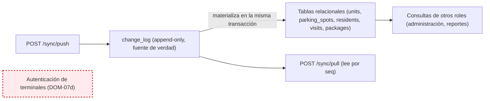

# Esquema de Base de Datos del Servidor Central — PostgreSQL 17

**Decisiones:** D-06, D-27, D-29 · **DDL ejecutable:** `crates/server/migrations/20261124000001_sync_inicial.sql`  
**Contrato:** `specs/contratos_api/protocolo_sincronizacion.md`  
**Estado:** 🟢 Motor confirmado (PostgreSQL) · 🟡 Modelo de tablas propuesto para el POC

---

## 1. Principio: log de cambios + tablas relacionales

- **`change_log`** guarda cada cambio recibido tal cual llegó; de ahí se sirve el Pull. Nunca se modifica ni se borra.
- **Tablas relacionales** reflejan el estado actual, con llaves foráneas, para que otros roles consulten con SQL normal.
- Si un cambio no puede materializarse (p. ej. viola una llave foránea), **igual se guarda en el log** y se anota el motivo en `change_log.apply_error`. La terminal no se bloquea reintentando.

## 2. Tablas

| Tabla | Clave | Columnas principales | Relaciones |
| :--- | :--- | :--- | :--- |
| `sync_nodes` | `node_id uuid` | `first_seen_at`, `last_seen_at` | — |
| `change_log` | `seq bigserial` | `change_id uuid UNIQUE`, `origin_node`, `collection`, `record_id`, `op`, `payload jsonb`, `created_at`, `received_at`, `apply_error` | `origin_node → sync_nodes` |
| `units` | `id text` | `tower`, `unit_number`, `unit_type`, `intercom`, `mobile`, `landline` | — |
| `parking_spots` | `code text` | `spot_type`, `assigned_unit_id` | `assigned_unit_id → units(id)` `ON DELETE SET NULL` |
| `residents` | `id text` | `full_name`, `document`, `role`, `mobile`, `email` | — |
| `resident_units` | `(resident_id, unit_label)` | — | `resident_id → residents(id)` `ON DELETE CASCADE` |
| `visits` | `id text` | `visitor_name`, `document`, `destination`, `access_type`, `entry_at`, `exit_at` | — |
| `packages` | `id text` | `destination`, `recipient`, `carrier`, `description`, `received_at`, `delivered_at` | — |

Todas las tablas de entidades llevan `updated_at timestamptz` y `updated_by uuid` (nodo que hizo el último cambio) para auditoría.

Los parqueaderos de un inmueble se obtienen de `parking_spots.assigned_unit_id`; no se duplican en `units`.

## 3. Reglas de consistencia

| ID | Regla |
| :--- | :--- |
| **RN-SRV-01** | Los Push se serializan con un bloqueo consultivo de PostgreSQL (`pg_advisory_xact_lock`). Así el orden de `seq` coincide con el orden de confirmación y un Pull nunca se salta un cambio que se confirme después. |
| **RN-SRV-02** | El cursor que devuelve el Pull es el `seq` del último cambio leído (no el máximo global), por la misma razón. |
| **RN-SRV-03** | Un Pull devuelve como máximo 5 000 cambios; el resto llega en la siguiente sincronización. |
| **RN-SRV-04** | Al arrancar con la base vacía, el servidor carga los mismos datos iniciales que las terminales (`specs/mocks_dummy_data/seed_estado_local.json`), para que todos los nodos partan del mismo estado. |
| **RN-SRV-N01** | El servidor **NO** debe rechazar un Push completo porque un cambio no se pueda materializar (ver §1). |
| **RN-SRV-N02** | El servidor **NO** debe aceptar cambios cuyo `origin_node` sea distinto del `node_id` de la petición. |

## 4. Pendientes

- 🔴 **[PENDIENTE POR DEFINIR]** Autenticación de terminales y TLS (DOM-07d). El POC solo escucha en `127.0.0.1`.
- 🔴 **[PENDIENTE POR DEFINIR]** Multi-copropiedad: hoy hay una sola unidad residencial por base de datos.
- 🔴 **[PENDIENTE POR DEFINIR]** Política de retención y respaldo de `change_log`.
