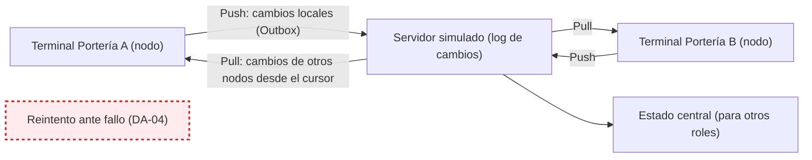

# Reglas de Negocio — Operación Local-First y Sincronización (POC)

**Proyecto:** Mamori  
**Módulo:** Resiliencia de Red / Sincronización Terminal ⇄ Servidor  
**Decisiones de origen:** D-22, D-23, D-24, D-25, D-26 (cierra DA-01)  
**Estado:** 🟢 Reglas confirmadas por el fundador · 🔴 ítems marcados como pendientes  
**Fecha:** 2026-11-24  

---

## 1. Contexto

La terminal de portería es la fuente principal de la información de la unidad residencial. Debe seguir operando sin internet y, en horarios fuera de hora pico, enviar sus cambios al servidor central y recibir los cambios de otras terminales. Mientras el servidor real no exista, se usa un **servidor simulado distribuido** (D-25).

---

## 2. Requerimientos (sintaxis EARS)

| ID | Tipo EARS | Requerimiento |
| :--- | :--- | :--- |
| **REQ-SYNC-01** | Ubicuo | La terminal **deberá** persistir en archivos locales todos los datos operativos: inmuebles, parqueaderos, residentes, visitas y paquetería. |
| **REQ-SYNC-02** | Evento | **Cuando** el vigilante registre o modifique un dato, la terminal **deberá** guardarlo en disco y agregarlo a la cola de envío (Outbox) antes de confirmar la acción en pantalla. |
| **REQ-SYNC-03** | Estado | **Mientras** no haya conexión con el servidor, la terminal **deberá** permitir todas las operaciones de portería sin degradación. |
| **REQ-SYNC-04** | Evento | **Cuando** el reloj local de la terminal alcance las **03:00, 10:00, 15:00 o 22:00**, la terminal **deberá** iniciar una sincronización (envío y luego recepción). |
| **REQ-SYNC-05** | Evento | **Cuando** el servidor confirme la recepción de un cambio, la terminal **deberá** retirarlo de la cola de envío. |
| **REQ-SYNC-06** | Evento | **Cuando** la terminal reciba cambios de otros nodos, **deberá** aplicarlos a sus archivos locales y refrescar la pantalla, excepto los que choquen con un cambio local pendiente (ver RN-SYNC-04). |
| **REQ-SYNC-07** | Estado | **Mientras** una sincronización esté en curso, el encabezado **deberá** mostrar, a la derecha del nombre del usuario, el estado `SINCRONIZANDO…`. |
| **REQ-SYNC-08** | Estado | **Mientras** no haya sincronización en curso, el encabezado **deberá** mostrar la fecha y hora (local) de la última sincronización exitosa, o `Nunca` si no ha habido ninguna. |
| **REQ-SYNC-09** | Evento | **Cuando** una sincronización falle, el encabezado **deberá** mostrar `SIN CONEXIÓN` junto con la fecha y hora de la última sincronización exitosa. |

---

## 3. Reglas de negocio

| ID | Regla |
| :--- | :--- |
| **RN-SYNC-01** | Las ventanas de sincronización son exactamente `03:00`, `10:00`, `15:00` y `22:00` en hora local de la terminal (D-23). |
| **RN-SYNC-02** | Cada sincronización ejecuta primero **Push** (enviar Outbox) y después **Pull** (recibir cambios de otros nodos desde el último cursor). |
| **RN-SYNC-03** | Un cambio es el **estado completo del registro** (upsert) identificado por `(colección, id)`. Si un registro se modifica varias veces antes de sincronizar, en la cola solo queda su última versión. |
| **RN-SYNC-04** | **Gana la terminal (D-24):** un cambio recibido del servidor **no** se aplica si la terminal tiene un cambio pendiente de envío para el mismo `(colección, id)`. El cambio local se envía en la siguiente ventana y prevalece. |
| **RN-SYNC-05** | El servidor es **idempotente**: si recibe dos veces el mismo `change_id`, lo registra una sola vez y confirma ambas veces. |
| **RN-SYNC-06** | El servidor nunca devuelve a un nodo sus propios cambios. |
| **RN-SYNC-07** | Los registros nuevos creados en la terminal usan identificadores UUID v4, para que dos terminales sin conexión no generen el mismo id. |

---

## 4. Restricciones negativas explícitas

| ID | El sistema **NO** debe… |
| :--- | :--- |
| **RN-SYNC-N01** | …bloquear, ralentizar ni pedir conexión para ninguna operación de portería. |
| **RN-SYNC-N02** | …borrar un cambio de la cola de envío sin confirmación explícita del servidor. |
| **RN-SYNC-N03** | …sobrescribir un cambio local pendiente con datos del servidor. |
| **RN-SYNC-N04** | …dejar un archivo de datos a medio escribir: toda escritura es atómica (archivo temporal + reemplazo). |
| **RN-SYNC-N05** | …sincronizar fuera de las ventanas definidas en RN-SYNC-01 en operación normal (el modo demo `MAMORI_SYNC_INTERVAL_SECS` es solo para desarrollo). |
| **RN-SYNC-N06** | …borrar visitas o paquetes al darles salida/entrega: se marcan con `exit_time` / `delivered_at` y se conservan. |

---

## 5. Pendientes por definir

- 🔴 **[PENDIENTE POR DEFINIR]** **DA-04** — Reintentos si una ventana falla. *POC: espera a la siguiente ventana.*
- 🔴 **[PENDIENTE POR DEFINIR]** **DA-05** — Sincronizar al encender si se perdió una ventana. *POC: no.*
- 🔴 **[PENDIENTE POR DEFINIR]** **DA-06** — Sincronización manual por el vigilante. *POC: no.*
- 🔴 **[PENDIENTE POR DEFINIR]** **DA-07** — Mostrar cantidad de cambios pendientes de envío. *POC: no.*
- 🔴 **[PENDIENTE POR DEFINIR]** Retención local de visitas y paquetes cerrados (cuánto tiempo se conservan en la terminal).

---

## 6. Trazabilidad

| Artefacto | Ubicación |
| :--- | :--- |
| Contrato de sincronización (DTOs) | `crates/shared/src/sync.rs` · `specs/contratos_api/protocolo_sincronizacion.md` |
| Formato de archivos locales | `specs/esquemas_bd/almacenamiento_local_poc.md` |
| Criterios de aceptación | `specs/criterios_gherkin/sincronizacion_local_first.feature` |
| Datos iniciales | `specs/mocks_dummy_data/seed_estado_local.json` |
| Implementación | `crates/client-desktop/src/{store.rs, sync.rs, sim_server.rs}` |
