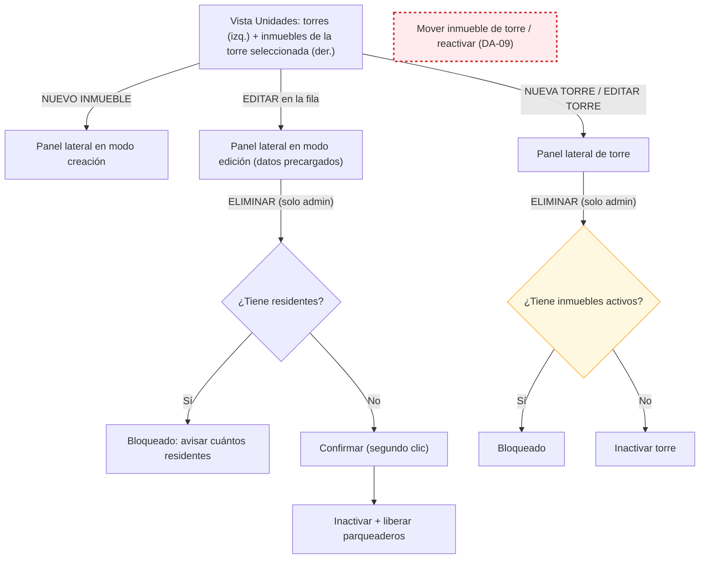

# Reglas de Negocio — CRUD de Unidades & Predios (Inmuebles y Torres)

**Proyecto:** Mamori · **Flujo:** `FLP-01` · **Módulo:** `[F7] UNIDADES & PREDIOS`  
**Decisiones de origen:** D-09, D-12, D-30, D-31, D-32, D-33  
**Estado:** 🟢 Confirmado · 🟡 propuestas marcadas · 🔴 pendientes marcados  
**Fecha:** 2026-11-24

---

## 1. Operaciones y permisos (D-33)

| Operación | Inmuebles | Torres / Bloques | Portería | Administrador |
| :--- | :---: | :---: | :---: | :---: |
| Ver (listar) | ✅ | ✅ | ✅ | ✅ |
| Crear | ✅ | ✅ | ✅ | ✅ |
| Editar | ✅ | ✅ (renombrar) | ✅ | ✅ |
| Eliminar (inactivar) | ✅ | ✅ | ❌ | ✅ |

---

## 2. Requerimientos (EARS)

| ID | Requerimiento |
| :--- | :--- |
| **REQ-UN-01** | **Cuando** el usuario seleccione una torre, la terminal **deberá** listar solo los inmuebles **activos** de esa torre. |
| **REQ-UN-02** | La lista de torres **deberá** mostrar, por cada torre activa, la cantidad real de inmuebles activos. |
| **REQ-UN-03** | **Cuando** el usuario pulse `EDITAR` en un inmueble, la terminal **deberá** abrir el panel lateral con sus datos y parqueaderos precargados. |
| **REQ-UN-04** | **Cuando** el usuario quite un parqueadero al editar un inmueble y guarde, ese parqueadero **deberá** volver a estar disponible. |
| **REQ-UN-05** | **Cuando** un Administrador elimine un inmueble, la terminal **deberá** pedir confirmación con un segundo clic en el mismo panel (sin modales centrados, D-13). |
| **REQ-UN-12** | **Cuando** el usuario haga clic en una fila de la tabla de inmuebles, la terminal **deberá** abrir un panel lateral derecho de solo lectura con la ficha completa del inmueble: torre, número, tipo, citófono, celular, teléfono fijo, parqueaderos (con su tipo), residentes asociados (rol y celular), visitas que están dentro y paquetes pendientes dirigidos a él; con acceso a `EDITAR`, a `ELIMINAR` (solo Administrador, con las reglas RN-UN-07 a RN-UN-09 y confirmación con segundo clic) y cierre con `ESC` (D-34). |

## 3. Reglas

| ID | Regla |
| :--- | :--- |
| **RN-UN-01** | No puede haber dos inmuebles **activos** con el mismo número en la misma torre (sin distinguir mayúsculas ni espacios extremos). |
| **RN-UN-02** | Todo inmueble debe tener al menos citófono o celular. El texto `Sin citófono` cuenta como vacío. |
| **RN-UN-07** | Eliminar un inmueble lo **inactiva** (`is_active = false`) y libera sus parqueaderos (D-31). |
| **RN-UN-08** | No se puede eliminar un inmueble que tenga residentes asociados (D-32). |
| **RN-UN-09** | Solo el rol `Administrador` puede eliminar inmuebles y torres. Los botones de eliminar **no se muestran** al rol `Portería` (ficha del inmueble, editar inmueble y editar torre); además la terminal vuelve a validar el rol al ejecutar la acción (D-33). |
| **RN-UN-10** | Al cambiar el número de un inmueble, las asociaciones de sus residentes (`Torre - Inmueble`) se actualizan automáticamente. |
| **RN-UN-11** | El tipo de inmueble es uno de: `Apartamento`, `Casa`, `Local`, `Oficina` (alineado con `UnitType` de `crates/shared`). |
| **RN-TR-01** | No puede haber dos torres activas con el mismo nombre (sin distinguir mayúsculas). |
| **RN-TR-02** | 🟡 **[PROPUESTA — DA-08]** Eliminar una torre la inactiva, y se bloquea si tiene inmuebles activos. |
| **RN-TR-03** | Al renombrar una torre, sus inmuebles y las asociaciones de residentes se actualizan automáticamente. |

## 4. Restricciones negativas

| ID | El sistema **NO** debe… |
| :--- | :--- |
| **RN-UN-N01** | …borrar físicamente un inmueble ni una torre (solo inactivar). |
| **RN-UN-N02** | …mostrar inmuebles o torres inactivos en listas, contadores ni selectores (incluido el selector de inmuebles de Residentes). |
| **RN-UN-N03** | …permitir al rol `Portería` eliminar, aunque invoque la acción por teclado o de otra forma. |
| **RN-UN-N04** | …dejar un parqueadero asignado a un inmueble inactivo. |

## 5. Pendientes

- 🔴 **[PENDIENTE POR DEFINIR]** **DA-09** — Mover un inmueble a otra torre al editarlo (POC: la torre no se puede cambiar) y reactivar inmuebles inactivados (POC: no).
- 🟡 **DA-08** — Confirmar RN-TR-02.
